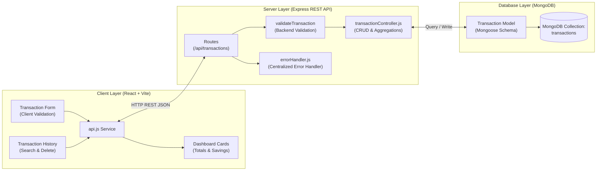

# 💰 Expense Tracker — CodeNova Internship Task 2

A clean, responsive, and robust **Full-Stack Expense Tracker Application** built as **Task 2 for the CodeNova Full Stack Development Internship**.

The application enables users to seamlessly log, manage, and analyze personal income and expense transactions in real time with end-to-end client/server validation, persistent storage in MongoDB, and an executive financial dashboard.

---

## 📌 Table of Contents
- [Project Overview](#-project-overview)
- [Key Features](#-key-features)
- [Tech Stack](#-tech-stack)
- [System Architecture](#-system-architecture)
- [Database Model](#-database-model)
- [REST API Documentation](#-rest-api-documentation)
- [Local Installation & Setup](#-local-installation--setup)
- [Environment Variables](#-environment-variables)
- [Manual Testing Guide](#-manual-testing-guide)
- [CodeNova Acceptance Criteria Checklist](#-codenova-acceptance-criteria-checklist)
- [Screenshots](#-screenshots)

---

## 🚀 Project Overview

Managing personal finances requires accuracy, real-time feedback, and reliable data persistence. This project delivers a production-quality financial tracking dashboard tailored to CodeNova's task specifications:
- **Zero reliance on paid APIs or external paid services.**
- **Dual-layer validation:** Validates form inputs on the client for immediate feedback and re-validates all fields on the Express backend before persisting to MongoDB.
- **Single Source of Truth:** All dashboard summaries (Total Income, Total Expenses, and Net Savings) are computed dynamically from actual MongoDB transactions.
- **Resilient Architecture:** Survives backend server reboots without data loss.

---

## ✨ Key Features

### 1. Transaction Entry & Logging
- Log both **Income** and **Expense** entries with title/description, amount, type, category, and date.
- Dynamic category selection based on transaction type:
  - **Expense Categories:** Food, Transport, Shopping, Education, Bills, Entertainment, Health, Other.
  - **Income Categories:** Salary, Freelance, Bonus, Other.
- Default date set to today for fast data entry.
- Amount enforces positive numbers greater than 0.

### 2. Live Dashboard Summary
- **Total Income Card:** Real-time aggregate of all income records.
- **Total Expenses Card:** Real-time aggregate of all outgoing expenses.
- **Net Savings Card:** Real-time calculation (`Total Income - Total Expenses`) with adaptive color highlights (green for positive balances, red for deficits).

### 3. Transaction History & Management
- Chronologically sorted transactions (**newest first**).
- Clear visual badges and icons distinguishing income (`+₹`) and expense (`-₹`).
- Category icon indicators and formatted dates.
- Instant **Delete Action** with optimistic UI updates and immediate recalculation of dashboard totals.
- Clean **Empty State** view when no transactions exist: *"No transactions yet. Add your first transaction."*
- Real-time **Search and Filter** by keyword, transaction type, or specific category.

### 4. Expense Breakdown Analytics
- Interactive visual breakdown displaying the percentage share and total spent across active expense categories with smooth gradient progress bars.

### 5. Toast Notifications & Feedback
- Floating toasts for successful additions, deletions, validation alerts, and network error reporting.

---

## 🛠 Tech Stack

| Layer | Technology | Description |
| :--- | :--- | :--- |
| **Frontend** | [React 18+](https://react.dev/) | Component-based UI library |
| **Build Tool** | [Vite](https://vitejs.dev/) | Lightning-fast development & production bundling |
| **Styling** | Modern Vanilla CSS | Custom design tokens, glassmorphism, responsive grid/flexbox, typography with Google Fonts (*Plus Jakarta Sans*) |
| **Icons** | [Lucide React](https://lucide.dev/) | Minimalist, consistent icon library |
| **Backend** | [Node.js](https://nodejs.org/) & [Express.js](https://expressjs.com/) | RESTful API server with custom middleware |
| **Database** | [MongoDB](https://www.mongodb.com/) | NoSQL document database |
| **ODM** | [Mongoose](https://mongoosejs.com/) | Schema modeling and database validation |
| **Environment** | `dotenv` & `cors` | Secret management and Cross-Origin Resource Sharing |

---

## 🏛 System Architecture

The following diagram demonstrates the data flow across the application layers:



### Flow Breakdown:
1. User enters transaction data into the React form.
2. Frontend validates required fields, numeric constraints, and date validity.
3. Form dispatches an HTTP request via the centralized `api.js` service to Express.
4. Express middleware `validateTransaction` validates the payload independently and returns `400 Bad Request` if invalid.
5. The controller saves the verified document to MongoDB via Mongoose.
6. The backend returns a structured JSON response (`{ success: true, data: ... }`).
7. The React client updates its local state, immediately updating the history list and dashboard totals.

---

## 🗄 Database Model

The Mongoose schema (`server/src/models/Transaction.js`) enforces strict constraints:

| Field | Type | Required | Constraints / Validation |
| :--- | :--- | :--- | :--- |
| `title` | `String` | Yes | Trimmed, 2 to 100 characters |
| `amount` | `Number` | Yes | Minimum `0.01` (must be greater than 0) |
| `type` | `String` | Yes | Enum: `['income', 'expense']`, lowercase, trimmed |
| `category` | `String` | Yes | Validated against allowed categories per type |
| `date` | `Date` | Yes | Valid date, defaults to current date |
| `createdAt` | `Date` | Auto | Timestamp generated by Mongoose |
| `updatedAt` | `Date` | Auto | Timestamp generated by Mongoose |

### Compound Index:
- An index on `{ date: -1, createdAt: -1 }` ensures fast retrieval for newest-first sorting.

---

## 📡 REST API Documentation

Base URL: `http://localhost:5000/api`

### 1. Get All Transactions
- **Method:** `GET`
- **URL:** `/transactions`
- **Query Parameters (Optional):**
  - `type`: `income` | `expense`
  - `category`: Filter by category name
  - `search`: Search transaction title
- **Response Status:** `200 OK`
- **Response Body Example:**
  ```json
  {
    "success": true,
    "count": 2,
    "data": [
      {
        "_id": "6adb26d1e5c862c7d7bb7c31",
        "title": "October Software Salary",
        "amount": 45000,
        "type": "income",
        "category": "Salary",
        "date": "2026-10-01T00:00:00.000Z",
        "createdAt": "2026-10-23T09:20:00.000Z",
        "updatedAt": "2026-10-23T09:20:00.000Z"
      }
    ]
  }
  ```

---

### 2. Create Transaction
- **Method:** `POST`
- **URL:** `/transactions`
- **Headers:** `Content-Type: application/json`
- **Request Body Example:**
  ```json
  {
    "title": "Grocery Shopping",
    "amount": 1850.50,
    "type": "expense",
    "category": "Food",
    "date": "2026-10-23"
  }
  ```
- **Response Status:** `201 Created`
- **Response Body Example:**
  ```json
  {
    "success": true,
    "message": "Transaction created successfully",
    "data": {
      "_id": "6adb26d1e5c862c7d7bb7c32",
      "title": "Grocery Shopping",
      "amount": 1850.5,
      "type": "expense",
      "category": "Food",
      "date": "2026-10-23T00:00:00.000Z",
      "createdAt": "2026-10-23T09:22:00.000Z",
      "updatedAt": "2026-10-23T09:22:00.000Z"
    }
  }
  ```
- **Error Response (400 Bad Request):**
  ```json
  {
    "success": false,
    "message": "Amount must be greater than zero",
    "errors": ["Amount must be greater than zero"]
  }
  ```

---

### 3. Get Single Transaction
- **Method:** `GET`
- **URL:** `/transactions/:id`
- **Response Status:** `200 OK` (or `404 Not Found` if nonexistent, `400 Bad Request` if invalid ID format)
- **Response Body Example:**
  ```json
  {
    "success": true,
    "data": {
      "_id": "6adb26d1e5c862c7d7bb7c31",
      "title": "October Software Salary",
      "amount": 45000,
      "type": "income",
      "category": "Salary",
      "date": "2026-10-01T00:00:00.000Z"
    }
  }
  ```

---

### 4. Delete Transaction
- **Method:** `DELETE`
- **URL:** `/transactions/:id`
- **Response Status:** `200 OK` (or `404 Not Found`)
- **Response Body Example:**
  ```json
  {
    "success": true,
    "message": "Transaction deleted successfully",
    "data": {
      "_id": "6adb26d1e5c862c7d7bb7c32",
      "title": "Grocery Shopping"
    }
  }
  ```

---

### 5. Get Financial Summary
- **Method:** `GET`
- **URL:** `/transactions/summary`
- **Response Status:** `200 OK`
- **Response Body Example:**
  ```json
  {
    "success": true,
    "data": {
      "totalIncome": 45000,
      "totalExpenses": 1850.5,
      "netSavings": 43149.5,
      "transactionCount": 2,
      "incomeCount": 1,
      "expenseCount": 1
    }
  }
  ```

---

### 6. Health Check
- **Method:** `GET`
- **URL:** `/health`
- **Response Status:** `200 OK`

---

## 💻 Local Installation & Setup

Follow these exact steps to run the application locally on your machine:

### Prerequisites:
- **Node.js** (v18 or higher recommended)
- **npm** (v9 or higher)
- **MongoDB** installed locally (or a free MongoDB Atlas connection URI)

---

### Step 1: Clone the Repository
```bash
git clone https://github.com/Yogesh0314/marathi-member-directory.git
cd Expense_tracker
```

### Step 2: Install Backend Dependencies
```bash
cd server
npm install
```

### Step 3: Install Frontend Dependencies
```bash
cd ../client
npm install
```

### Step 4: Configure Environment Variables
Inside `server/`, create a `.env` file (or copy from `.env.example`):
```bash
# In server/.env
PORT=5000
NODE_ENV=development
MONGODB_URI=mongodb://127.0.0.1:27017/expense_tracker
CLIENT_URL=http://localhost:5173
```

Inside `client/`, optional `.env` (or copy from `.env.example`):
```bash
# In client/.env (leave blank to use Vite development proxy)
VITE_API_BASE_URL=
```

### Step 5: Ensure MongoDB is Running
If using local MongoDB on Windows:
```powershell
net start MongoDB
```
Or start mongod manually:
```bash
mongod
```

### Step 6: Start the Backend Server
From the `server/` directory:
```bash
npm run dev
```
*The server will start on `http://localhost:5000` and connect to MongoDB.*

### Step 7: Start the Frontend Client
Open a second terminal window and navigate to `client/`:
```bash
npm run dev
```
*The frontend Vite dev server will start at `http://localhost:5173`.*

Open your browser and navigate to:
```
http://localhost:5173
```

---

## 🔐 Environment Variables

| Variable | Environment | Description | Default Value |
| :--- | :--- | :--- | :--- |
| `PORT` | Backend (`server/.env`) | Port where Express listens | `5000` |
| `NODE_ENV` | Backend (`server/.env`) | Node environment | `development` |
| `MONGODB_URI` | Backend (`server/.env`) | MongoDB connection string | `mongodb://127.0.0.1:27017/expense_tracker` |
| `CLIENT_URL` | Backend (`server/.env`) | Allowed CORS origin | `http://localhost:5173` |
| `VITE_API_BASE_URL` | Frontend (`client/.env`) | Backend API base path | *Empty string (proxied via Vite)* |

> ⚠️ **Security Notice:** Never commit actual `.env` files to Git. Both `.env` files are ignored in `.gitignore`.

---

## 🧪 Manual Testing Guide

Use the following step-by-step checklist to verify full functionality:

### 1. Test Adding Income
1. In the form, select **Income**.
2. Enter Title: `"Monthly Salary"`.
3. Enter Amount: `50000`.
4. Select Category: `"Salary"`.
5. Select today's date and click **Add Income**.
6. **Expected Result:**
   - Success toast appears: *Added income: "Monthly Salary"*.
   - Total Income card increases by ₹50,000.
   - Net Savings card increases by ₹50,000.
   - Transaction appears at the top of the history list with a green `+₹50,000.00` badge.

### 2. Test Adding Expense
1. Select **Expense**.
2. Enter Title: `"Apartment Rent"`.
3. Enter Amount: `15000`.
4. Select Category: `"Bills"`.
5. Click **Add Expense**.
6. **Expected Result:**
   - Success toast appears.
   - Total Expenses card displays ₹15,000.
   - Net Savings card displays `₹35,000` (`₹50,000 - ₹15,000`).
   - Transaction appears in history with a rose `-₹15,000.00` badge.

### 3. Test Form Validation (Frontend & Backend)
1. Submit the form with an empty title:
   - Frontend validation error appears: *"Title/description is required"*.
2. Enter an invalid amount (`0` or negative `-50`):
   - Validation error appears: *"Amount must be a positive number greater than 0"*.
3. Verify that sending an invalid POST request directly via Postman or curl returns HTTP `400 Bad Request` with `{ "success": false, "message": "..." }`.

### 4. Test Deleting a Transaction
1. Click the **Trash icon** next to `"Apartment Rent"`.
2. **Expected Result:**
   - Transaction is removed from the history list immediately.
   - Total Expenses drops back to ₹0.
   - Net Savings updates immediately to ₹50,000.
   - Toast displays: *Deleted transaction "Apartment Rent"*.

### 5. Test Persistence Across Server Restarts
1. Add 2 transactions.
2. Stop the Express server in your terminal (`Ctrl + C`).
3. Restart the server (`npm run dev`).
4. Refresh the frontend page (`F5`).
5. **Expected Result:** All transactions and totals persist intact from MongoDB.

---

## ✅ CodeNova Acceptance Criteria Checklist

- [x] **Transaction logging form works** (adds income and expenses cleanly).
- [x] **Client-side validation works** (validates title, positive amount, category, date).
- [x] **Server-side validation works independently** (returns 400 Bad Request on invalid payloads).
- [x] **Income card displays correct total** (sum of all income items).
- [x] **Expense card displays correct total** (sum of all expense items).
- [x] **Net savings displays Income - Expenses** (dynamic styling for positive/negative balances).
- [x] **Transaction history works** (displays newest transactions first).
- [x] **Categories are displayed** (with category badge and specific icons).
- [x] **Transactions can be deleted** (with instant UI state update).
- [x] **Data persists in MongoDB** (stored with Mongoose schema).
- [x] **Data survives backend/server restart** (MongoDB remains source of truth).
- [x] **Frontend dashboard totals match backend data** (derived directly from persisted records).
- [x] **Responsive UI works on desktop and mobile** (tested with responsive flexbox and CSS grid).
- [x] **Network/API errors are handled gracefully** (user-friendly toasts; no leaked stack traces).
- [x] **README is complete** (comprehensive overview, architecture, endpoints, and setup).
- [x] **API documentation is included** (methods, endpoints, request/response formats, and status codes).
- [x] **Database model is documented** (fields, types, constraints, indexes).
- [x] **No secrets/API keys are committed** (clean `.gitignore`, `.env.example` provided).
- [x] **Project can be run locally using documented commands** (simple step-by-step instructions).

---

## 📷 Screenshots

*(Placeholder section: Add your application screenshots here for final internship submission)*

### 1. Dashboard & Add Transaction


### 2. Transaction History & Filtering


### 3. Mobile Responsive View


---

## 👨‍💻 Author & Submission Details
- **Developer:** CodeNova Full Stack Development Intern
- **Task:** Task 2 — Full Stack Expense Tracker Application
- **Internship Organization:** CodeNova
